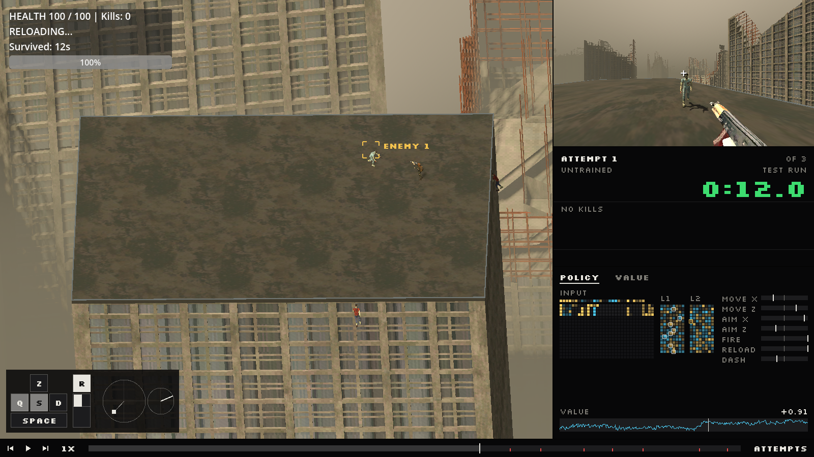
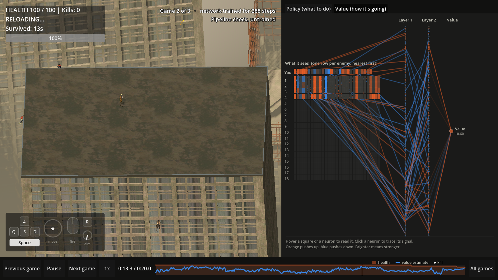
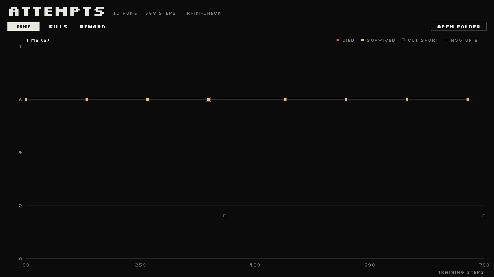

# Reinforcement-learning pipeline

Training runs on **Kaggle or Colab** with `zombie_training.ipynb`. Every game played
during training is recorded, and the Godot viewer replays any of them next to the
network that played it. The viewing PC needs only Godot: no Python, torch or GPU.

No successful survival agent has been trained yet. Local runs are wiring checks only.

## Files

- `../training.tscn`: persistent training scene; instances `game.tscn` for each round.
- `training_session.gd`: seeded round creation/cleanup; keeps Sync/controller alive.
- `zombie_rl_controller.gd`: 590 observations, seven action values, reward and endings.
- `training_sync.gd`: small subclass of the vendored Godot RL Agents Sync.
- `zombie_env.py`: Gymnasium adapter for one Godot process on Windows/Linux.
- `train.py`: PPO training, checkpoints, resume, time budget, starting noise.
- `evaluate.py`: plays a saved model with exploration noise off on unseen rounds.
- `zombie_training.ipynb`: the Kaggle/Colab notebook (setup, checks, training, progress plot).
- `recording.py`: writes every episode and one weight snapshot per PPO rollout.
- `replay_format.py`: numpy-only reader and forward pass, used by tests and the notebook.
- `replay.tscn`, `replay_player.gd`: the viewer. `replay_archive.gd` reads recordings and
  reruns the network; `brain_view.gd`, `inputs_view.gd`, `timeline_view.gd` and
  `progress_view.gd` draw its panels.
- `replay_capture.gd`: read-only samples of models, animations and ragdoll bones.
- `smoke_test.py`, `smoke_test_replays.py`: connection and recording/playback checks.

The numerical observation schema is unchanged: see `../AI_OBSERVATIONS.md`.

## Training on Kaggle or Colab

Upload or open `training/zombie_training.ipynb` and follow the steps at its top: turn
internet on (Kaggle) and run all cells. The repository is public, so no login is
needed. It downloads Godot 4.6.3 for Linux, installs the pinned packages in their
own environment, runs the two wiring checks, then trains headless.

- Kaggle: use **Save Version → Save & Run All** for long runs; output stays in
  `/kaggle/working/runs`. To continue later, attach the previous version as an input;
  its `runs` folder is copied in and training resumes from the newest checkpoint.
- Colab: recordings are written directly to `MyDrive/zombie-apocalypse-runs`.
- `--hours` stops and saves cleanly before the session limit (default 11 h in the notebook).

Run locally only to check wiring (Linux example; `.venv` is ignored by git):

```bash
uv venv --python 3.12 .venv
uv pip install --python .venv/bin/python torch==2.14.1 --index-url https://download.pytorch.org/whl/cpu
uv pip install --python .venv/bin/python -r training/requirements.txt
godot --headless --path . --editor --import --quit
.venv/bin/python training/smoke_test.py
.venv/bin/python training/smoke_test_replays.py
```

The Godot executable defaults to `godot` on PATH (Linux) or the Windows path in
`zombie_env.py`; override with `--godot` or `GODOT_BIN`. Headless mode disables
rendering, not enemy collisions or ragdolls.

## Actions

The action space is `Box(-1, 1, shape=(7,))`, in this order:

| Index | Meaning |
| --- | --- |
| 0 | Movement world X |
| 1 | Movement world Z |
| 2 | Mouse movement, screen right (world +X) |
| 3 | Mouse movement, screen down (world +Z) |
| 4 | Shoot if positive |
| 5 | Request reload if positive |
| 6 | Request dash if positive |

Movement length is capped at 1. The AI aims the way a player does: it moves a
virtual mouse cursor over the ground and the gun points at it, by the same rule as
`aim_at_mouse()`. Actions 2-3 are how hard it pushes the mouse; cursor speed is capped
at `ai_cursor_max_speed` (60 units/s) and builds up at `ai_cursor_acceleration`
(600 units/s², about 0.1 s to full speed), so aim is continuous and can't snap.
The cursor stays within the overhead view, and its position and speed are part of
the observation (schema v3, 590 values).
Shooting is held across physics ticks; reload/dash are one-shot requests per action.
Sending another positive button value on the next decision is another request.
Ammo, cooldowns, automatic empty-magazine reload, dash commitment and slowdown
follow the existing player script.

Each decision advances four 60 Hz physics ticks (about 0.0667 simulation seconds).
The headless process can run faster than real time. It pauses between decisions,
so Python update time does not give enemies extra simulation time.

## Episodes, reward and correct terminal data

- Default round length: 60 simulation seconds. Configure with `--episode-seconds`.
- Death sets `terminated=True`; reaching the time limit sets `truncated=True`.
- Death takes priority if both happen in the same tick.
- Final observation/info is retained and sent before reset.
- Gymnasium/SB3 performs reset after receiving that final transition.
- Reset creates fresh player/enemies/projectiles/ragdolls, with full ammo/health.
- The gameplay instance stays frozen after reset until the first action arrives.
- `reset(seed=...)` reproduces that seed's starting round. Ordinary resets advance
  through the seed sequence. Changing the base seed restarts the Godot process.

Reward, weighted towards surviving and dodging (`DEFAULT_REWARD` in `zombie_env.py`):

```text
alive   +0.1  per simulated second      (a full 60 s round: +6)
damage  -0.05 per health point lost     (zombie bite -0.5, hound charge -0.9)
death   -3.0
kill    +0.5
dodge   +0.5  per hound charge dodged
```

A charge counts as dodged when the player moved at least 1 m off the spot the
hound locked onto and the hound still came within 3 m without hitting, so
standing still or hiding in the crowd earns nothing. Change any weight with
`--reward name=value` (train.py and evaluate.py) or `REWARD` in the notebook;
each recording stores the weights it used. Collisions and falls are counted but
not rewarded. No resupply has been added; the player still has 60 total rounds.
Judge these weights from real replays before treating them as final.

The upstream Python wrapper duplicates done into both termination/truncation and
does not implement the Gymnasium terminal/reset contract we need. `ZombieEnv`
therefore uses its transport with an explicit Gymnasium adapter. This ensures PPO
can bootstrap timeouts correctly and SB3 can preserve `terminal_observation`.
The upstream addon itself is vendored unchanged.

## Training and checkpoints

```bash
python training/train.py --steps 2000000 --hours 11 --resume latest --output runs/ppo
```

- `--resume latest` picks the newest checkpoint or `survivor.zip` in `--output`
  (starts fresh if there is none). `--steps` counts additional decisions.
- `--n-steps` (default 2048) is the PPO rollout length. One weight snapshot is
  recorded per rollout, so this also sets how many snapshots are stored.
- Checkpoints every 10,000 decisions in `checkpoints/`, `survivor.zip` at the end,
  Monitor CSVs per session, and the recordings in `replays/`.
- Two 128-unit Tanh layers for the actor and two for the critic, `MlpPolicy`, CPU.
- `--noise` (default 1.0) is the starting exploration noise: PPO adds random noise
  with this standard deviation to every action so it keeps trying new things, then
  learns how much noise to keep. The viewer shows the noise of each attempt.

## Evaluation (noise off)

Training games are noisy on purpose, so they understate what the network can do.
`evaluate.py` plays a saved model with the noise off (always its most likely
action) on rounds it never trained on, records them next to the training games and
prints survival, kills, collisions and falls:

```bash
python training/evaluate.py --model latest --games 10 --output runs/ppo
```

Evaluation games appear in the viewer marked EVALUATION / NO NOISE, and as diamonds
on the attempts screen (they are left out of the training average).

## Collision and fall stats

The game counts, per round: zombie-on-zombie collisions that knock someone down,
hound charges that knock a zombie down, zombies tripping on tight turns, and enemies
that fall off the building. They are not rewarded; they show whether the AI learns
to make enemies collide or fall on its own. They appear in the training CSV, the
episode index, the run panel and the attempts screen, and on the human HUD.

Do not claim survival performance from a short run. Judge it from the progress
screen or the notebook's plot across many games.

## Watching recorded games



Screenshots come from untrained wiring-check recordings, not a trained survivor.

Copy the downloaded `ppo` folder into `training/runs/` (or anywhere), open
`training/replay.tscn` in the editor and press **F6**. Each training episode is an
**attempt**, shown like a speedrun:

- **Overhead feed** (left): the original rooftop, city, characters and gun from the
  game's overhead camera, with the game's own HUD. Bottom left is an input display
  of what the network pressed: ZQSD (lit in proportion, since movement is analog),
  Space, R, the mouse button, plus a stick for the exact movement and a dial for the aim.
- **First-person feed** (top right): the same moment through the game's FPS camera,
  with the survivor's arms on the rifle, looking where the network aims.
- **Run panel**: attempt number, how far training had got, a run timer (green while
  alive, red on death, gold for surviving the round) and kill splits compared with
  the best attempt so far (most kills), in green when faster and red when slower.
- **Network**: POLICY shows the action network, VALUE the critic. INPUT is the 590
  numbers it sees, one row for the survivor and one per enemy, nearest first;
  L1 and L2 are the two 128-neuron layers; the meters on the right are what it
  wanted, with a white tick for what was actually sent. Warm is positive, cold is
  negative. Hover anything to read its name and value; hovering an enemy row
  brackets that enemy on the overhead feed. Click a neuron to outline the inputs
  that drove it. The strip below is the critic's value across the attempt.
- **Bottom bar**: previous / play / next attempt, speed, and the attempt's track
  (gold ticks for kills, red for hits taken, white for zombie collisions, cyan for
  a zombie falling off; click or drag to seek). SAVE VIDEO renders the attempt.
- **ATTEMPTS** (or Tab): every attempt in training order, by time, kills or reward,
  with a running average. Click one to watch it. OPEN FOLDER picks another download.




### Saving a video

SAVE VIDEO renders the attempt you are watching to `training/videos/attempt-N.avi`
(1280x720, 30 fps) in a second Godot window, using Godot's Movie Maker so every
frame is captured even if your PC can't render it in real time. The same from a
terminal (attempt 12):

```bash
godot --path . res://training/replay.tscn -- --run=training/runs/ppo --episode=12 --save-video
```

Movie Maker takes its size from project settings, not `--resolution`, so the viewer
passes it through a one-off `override.cfg` that the renderer deletes as soon as it
starts; the frame rate is passed as `--fixed-fps 30`.

The AVI (MJPEG) is large; YouTube accepts it, or shrink it with
`ffmpeg -i attempt-12.avi -c:v libx264 -crf 18 attempt-12.mp4`. Replays have no sound.
Rendering needs a graphics card or display, so make videos on your PC, not on Kaggle.

Keys: Space play/pause, Left/Right one decision (Shift: one second), Home/End,
Page Up/Page Down previous/next attempt, 1/2 policy/value, Tab attempts.

The viewer recomputes every activation in GDScript from the weights that made
that decision. If they don't reproduce the value/log-probability recorded live,
the panel says so. Headless check of a recording:

```bash
godot --headless --path . res://training/replay.tscn -- --run=/path/to/runs --check
```

### What is stored

One folder per training session under `replays/`, so resumed runs never overwrite:

- `manifest.json`: format 2, observation schema, the weight layout.
- `policies.json` and `policies/<sha256>.bin`: raw float32 weights, input-major,
  saved once before each PPO rollout and checked against their hash when loaded.
- `episodes/<id>.bin.gz`: float32 observations (T+1), applied and sampled actions,
  rewards, live values and log-probabilities.
- `episodes/<id>.json.gz`: world samples (T+1), status, seed, training step range
  and which weight snapshot made each decision.
- `index.json`: one summary row per game (time, kills, reward, collisions, falls, dodges, training
  steps and `trained_hours`, wall-clock training time that keeps counting across resumed sessions).
- `manifest.json` also says whether the session is `training` (noisy) or `evaluation`.

Games are saved when they end, and partly after each rollout (`in_progress`, then
`interrupted` if the session stops). A hard crash can lose decisions since the last
rollout. Samples are at 15 decisions/s; playback interpolates between them, but
events shorter than a sample can be missed and there is no audio or muzzle flash.
A 20 s game is about 0.4 MB, a weight snapshot about 0.74 MB. Keep the matching
project/assets for playback, and always download the whole folder including
`policies/`.

## Diagnostics

- Godot output: ignored `training/runs/godot-11008.log`.
- A connection failure raises an error instead of silently falling back to training
  from human inputs. The adapter closes its own child process when finished.
- `game.tscn` remains the normal F6 human-play scene. `training.tscn` is launched
  automatically by Python; opening it alone does not start a trainer.
- The addon contains optional C# ONNX inference files, but this pipeline uses
  Python inference/training and does not instantiate them. The standard Godot
  executable is used for the checks; no .NET installation is required here.
- Only one instance is supported by this first adapter. Parallel workers and
  throughput benchmarking are subsequent work.

## Third-party component

Godot RL Agents plugin, MIT, by Edward Beeching and contributors:
https://github.com/edbeeching/godot_rl_agents_plugin

Vendored source revision: `998c357a0cd09b37f40a36d70c7867fc9f682338`.
License: `../addons/godot_rl_agents/LICENSE`.
Python package: `godot-rl==0.8.2`. Communication protocol: 0.7.
